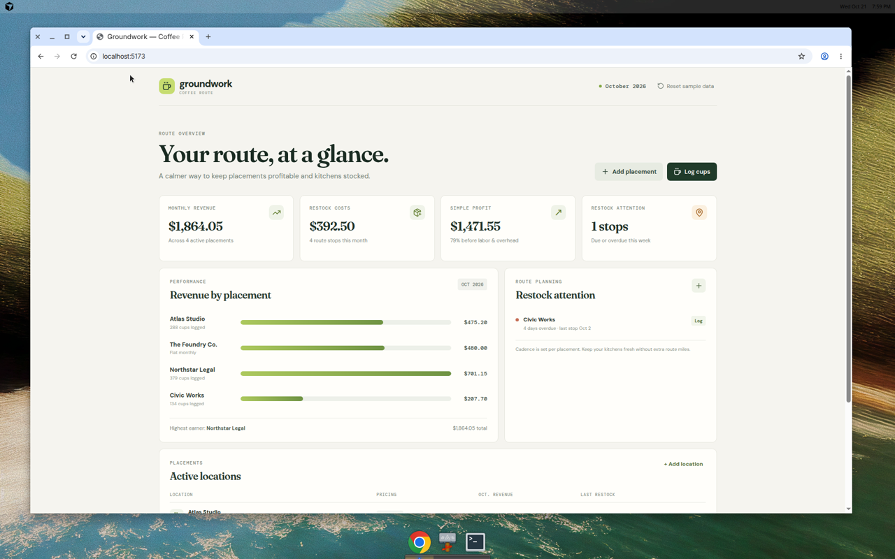
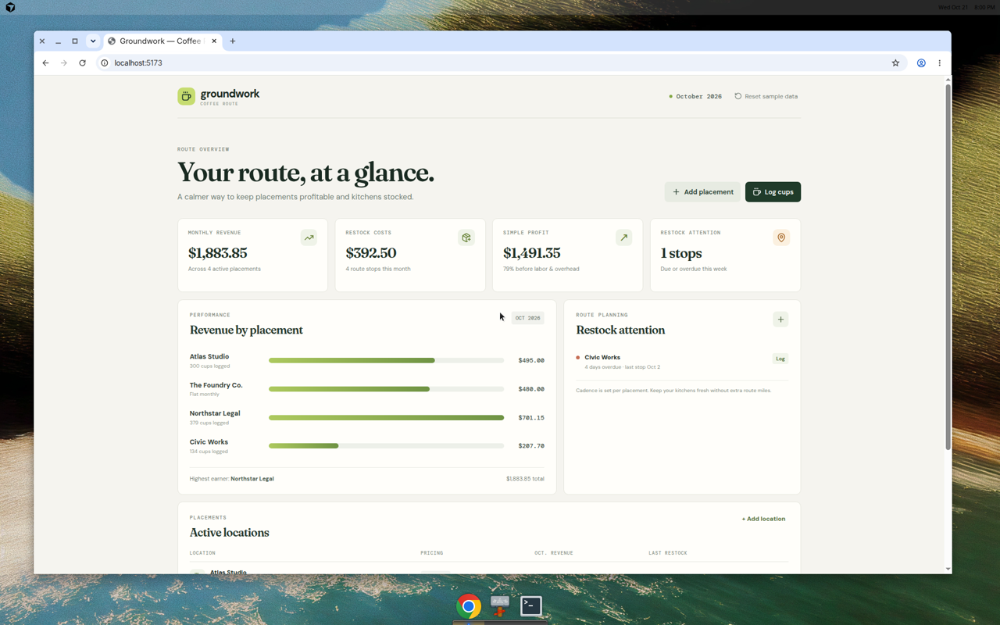

# Groundwork — Coffee Route Tracker

A small, polished operational dashboard for an independent coffee-machine placement business.





## Why it exists

Many small coffee routes install machines in offices for free, then earn through a per-cup charge or a flat monthly placement fee. The business is simple, but knowing which offices are profitable and which kitchens need a restock can otherwise mean juggling notes and spreadsheets.

Groundwork turns that practical workflow into one calm dashboard:

- Add and edit office placements with install dates, pricing, and restock cadence.
- Log cups sold and restock events against each location.
- See monthly revenue, restock costs, simple profit, and locations that need attention.
- Keep data in the browser with `localStorage`—no accounts, infrastructure, or setup required.

The app opens with clearly marked fictional sample data so the route feels alive immediately. Use **Reset sample data** to restore it at any time.

## Screenshots

The screenshots above are from a working local build using the fictional route. The second shows the dashboard after logging 12 cups at Atlas Studio; that placement's revenue and the route total update immediately.

## Tech stack

- React 18 + TypeScript
- Vite
- Vitest for revenue-math unit tests
- GitHub Actions for build/test CI and GitHub Pages deployment
- `localStorage` for lightweight persistence

## Run locally

```bash
npm install
npm run dev
```

Then open the local URL Vite prints (normally `http://localhost:5173`).

## Test and build

```bash
npm test
npm run build
```

The test suite covers monthly per-cup revenue, flat-fee revenue, and month-scoped restock totals.

## Deploy

The included GitHub Pages workflow publishes the production build after changes land on `main`. In the repository settings, set **Pages → Build and deployment → Source** to **GitHub Actions** once to enable it.